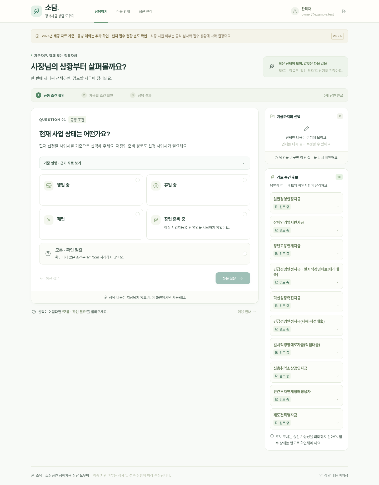
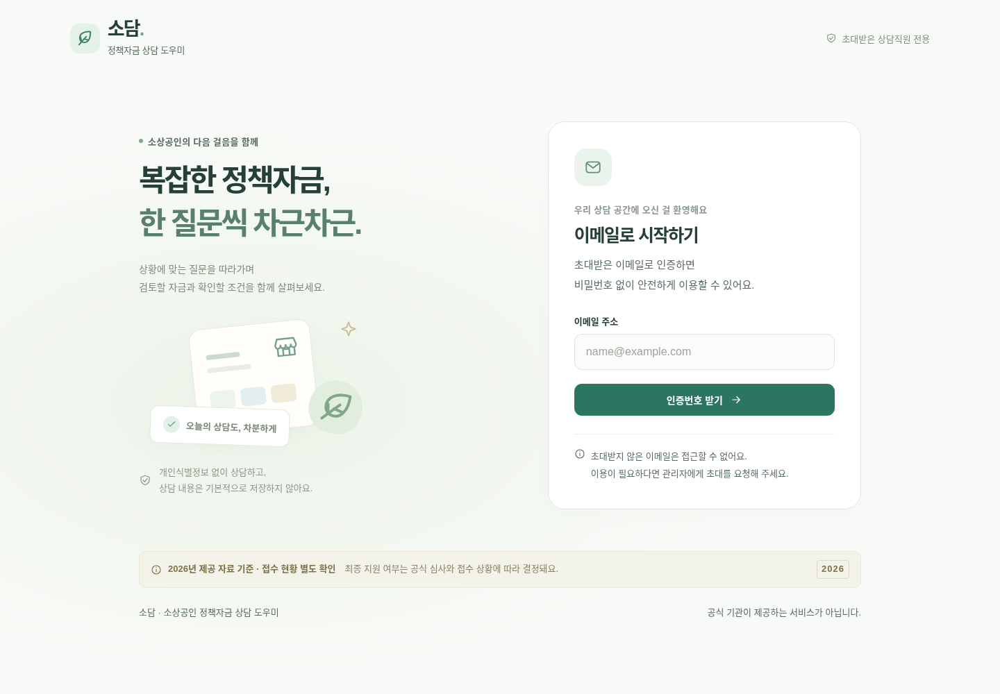
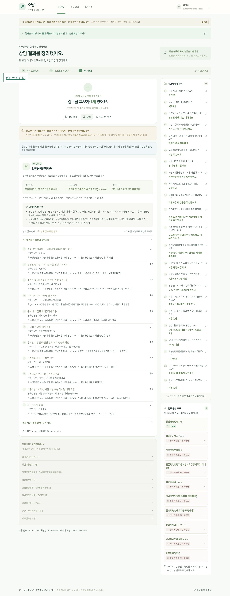
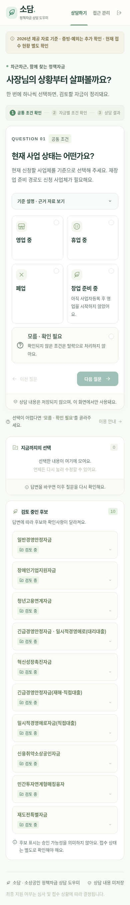

# 소담 — 소상공인 정책자금 상담 도우미

한 번에 질문 하나를 선택하면서 후보 자금을 좁히는 상담 보조 웹사이트입니다. 따뜻한 흰색·민트색 화면, 복수 선택, 모름 추가 확인, 이전 답변 수정, 결과 복사·인쇄, 초대 이메일 인증과 관리자 권한 회수를 구현했습니다.

**2026년 첨부 자료 기준 첫 버전입니다.** 제공된 PDF 4개·HWP 8개를 대조하여 대리대출 4종과 직접대출 6종을 반영했습니다. 문서 확인일은 2026-10-15입니다. 현재 접수·예산, 이후 개정 및 실제 정책자금 기준금리 숫자는 별도 확인이 필요합니다. 복잡한 예외·증빙은 기준 설명을 펼쳐 확인하고, 확인하지 못한 항목은 모름으로 남깁니다.

공개 HTTPS 배포와 실제 메일 배달은 호스팅·SMTP 연결 전까지 미완료입니다. 자동 검증은 실제 서버와 Chromium에서 테스트 전송기를 사용합니다. 로컬 검증을 공개 배포라고 표현하지 않습니다.

## 이용 흐름

1. 초대된 이메일로 인증번호를 요청합니다. 받은 8자리 번호로 로그인합니다. 비밀번호는 사용하지 않습니다.
2. 공통 조건을 선택하고 필요한 세부 질문으로 이동합니다. 목적은 복수 선택할 수 있습니다.
3. 옆의 선택 요약에서 답변을 수정하면 해당 단계 이후 답변과 결과를 다시 계산합니다.
4. 결과에서 충족·미충족·추가 확인사항과 근거를 확인하고 복사·인쇄합니다. `다시 상담하기`는 상담 내용을 초기화합니다.
5. 관리자는 초대 관리에서 이메일을 추가·회수합니다. 초대 대상에게 사이트 주소를 전달하면 해당 이메일 인증 후 이용할 수 있습니다. 권한 회수는 기존 로그인 세션에도 적용됩니다.

## 실행 — 개발 담당자용

요구 도구: Node.js **24.x**, npm. 브라우저 검증에는 Chromium이 필요합니다.

```bash
npm ci
npm test
npm run build
cp .env.example .env
# .env에 관리자 이메일·SMTP·APP_ORIGIN·DATA_DIR을 설정한 뒤
npm start
```

`.env`는 Git에서 제외되어 있습니다. `DATA_DIR`는 저장소 밖의 전용 영구 디렉터리를 사용합니다. `.env.example`의 빈 값은 실제 인증정보를 의미하지 않습니다. 이메일 발송 미설정 시 인증 요청은 닫힌 상태로 실패합니다. 운영 모드에서는 HTTPS origin과 SMTP 설정이 없으면 서버 시작을 거부합니다.

화면을 수정하며 실행할 때는 `.env`의 `NODE_ENV=development`, `APP_ORIGIN=http://localhost:5173`으로 설정한 뒤 터미널 두 개에서 `npm run dev:server`와 `npm run dev`를 실행합니다. API는 Vite 프록시로 같은 origin에서 호출됩니다. 완성된 빌드를 서버로 실행할 때는 `APP_ORIGIN`을 해당 서버 origin으로 다시 맞춥니다. 호스트명·포트·scheme이 정확히 일치해야 합니다.

상담 결과는 React 메모리와 요청 처리 중에만 존재하며 URL·브라우저 저장소·DB·로그에 저장하지 않습니다. 새로고침하면 상담 내용은 초기화됩니다. 인증 이메일·권한·세션 해시는 별도 SQLite DB에만 저장합니다. 인증 세션은 최대 7일이며, 회수·로그아웃·만료되면 사용할 수 없습니다.

## 검증

```bash
npm test             # 분기·경계값 + 실제 HTTP 인증/권한 검증
npm run build
npm run test:e2e     # 실제 Chromium 선택·결과·초대·차단·회수 검증
# 모두 실행
npm run check
```

Chromium이 `/usr/bin/chromium`에 있으면 자동 사용합니다. 다른 설치 경로는 `PLAYWRIGHT_CHROMIUM_EXECUTABLE`로 지정합니다. 브라우저가 없으면 개발 환경에서 `npx playwright install chromium`을 실행합니다.

E2E는 독립 테스트 서버와 `.data/e2e`에 테스트 전용 인증 DB·임시 메일 파일을 만듭니다. 테스트용 이메일은 실제로 전송하지 않으며, 메일 파일을 제공하는 웹 엔드포인트나 운영 인증 우회는 없습니다. Docker 운영 이미지에는 테스트 코드가 들어가지 않습니다. 테스트 결과와 trace에는 테스트 데이터만 사용해야 합니다.

## 조건·질문 수정

| 파일 | 역할 |
| --- | --- |
| [조건표](docs/conditions.md) | 자금별 명시 조건과 근거 |
| [질문 분기표](docs/question-flow.md) | 질문 순서·생략·모름·답변 변경 규칙 |
| [자료 확인 기록](docs/source-review.md) | 공식 자료 접근 결과와 적용 절차 |
| `policy/catalog.js` | 자금 정보와 질문·근거 결합 |
| `policy/questions.js`, `policy/rules.js` | 질문·선택지 및 명시적인 AND/OR 조건 |
| `policy/agency-data.js`, `policy/direct-data.js`, `policy/sources.js` | 문서별 조건·한도·금리·서류·절차·출처 |
| `policy/engine.js` | 결정론적 조건 평가와 경로 정규화 |
| `src/` | 화면·접근성·반응형 스타일 |
| `server/app.js` | 인증·초대·세션·권한·평가 API |
| `server/main.js` | 환경변수·SMTP·서버 시작 |
| [검증 결과](docs/validation.md) | 실행한 검증과 남은 제한 |
| [배포 안내](docs/deployment.md) | 필요한 최소 서비스 연결과 배포 후 확인 |

공고 변경 시 먼저 조건표와 분기표에 문서명·페이지/항목·공식 링크·적용 연도·확인일을 적습니다. 그다음 데이터를 수정하고 관련 경계값과 경로 검증을 갱신합니다. 자료에 없는 조건은 추가하지 않습니다. 접수 상태는 자격 조건과 별도 필드입니다. `node scripts/export-policy-docs.js`로 조건표·분기표를 갱신할 수 있습니다. 자료의 문구·예외를 먼저 대조하고 테스트를 함께 수정합니다. 첨부 원문과 전문 추출본은 `docs/sources/`에 로컬 보관하며 Git·정적 사이트·Docker 이미지에 포함하지 않습니다.

## 배포 상태

배포용 Dockerfile의 빌드와 컨테이너 서버 기동을 확인했습니다. 단일 Node 서비스, 영구 볼륨, HTTPS 주소, SMTP 발송 설정, 최초 관리자 이메일이 필요합니다. 사용자에게 GitHub 저장소 생성이나 개발 도구 설치를 요구하지 않으며, 현재 저장소와 소스를 그대로 배포할 수 있습니다. 외부 계정·서비스 연결이 없는 상태에서 공개 URL을 만들어냈다고 주장하지 않습니다. 자세한 설정과 운영 후 인증 검증은 [배포 안내](docs/deployment.md)를 따릅니다.

## 구현 화면

아래는 실제 브라우저에서 생성한 화면입니다. 이 README는 실행 중인 상담 사이트가 아닙니다.



<details><summary>로그인·결과·휴대전화 화면</summary>







</details>
