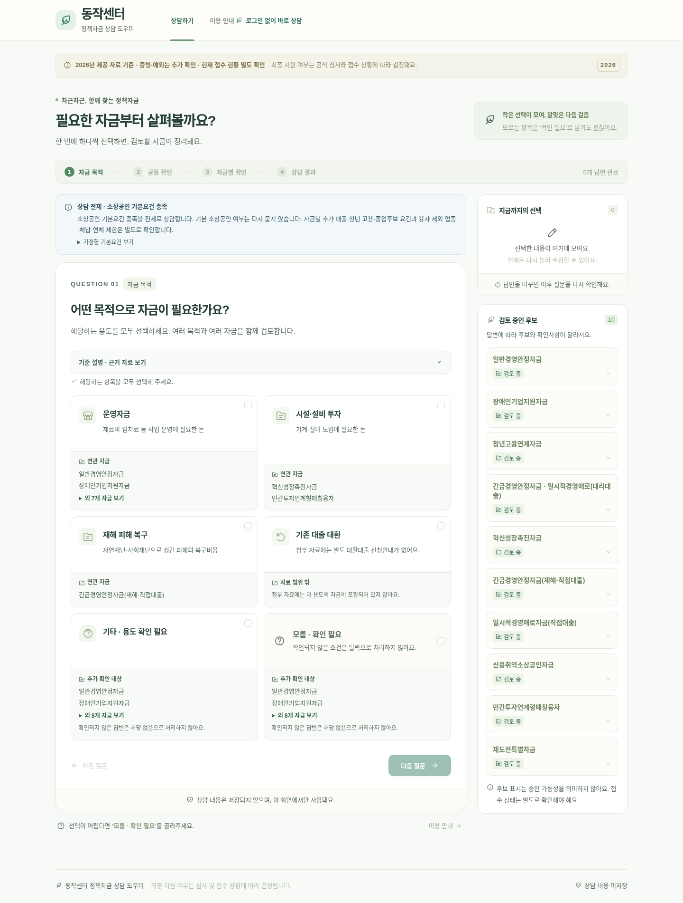

# 동작센터 정책자금 상담 도우미

**[사이트 바로 열기](https://pty9945-tech.github.io/SEMAS/)**

누구나 로그인 없이 웹브라우저에서 질문을 선택하고 정책자금 검토 결과를 볼 수 있습니다. 사용자의 요청에 따라 초대·이메일 인증 없이 이용하는 공개형을 기본으로 제공합니다. 별도 프로그램·메일 서비스·서버·환경변수 설정이 필요 없습니다.

## 이용 방법

1. 소상공인 기본요건을 충족한 것으로 보고, 자금 사용 목적부터 선택합니다. 기본 근로자 수·업종별 소기업 매출·사업자 형태·지위유지는 다시 묻지 않습니다.
2. 각 선택지 아래 연관 자금명을 볼 수 있습니다. 목록이 길면 나머지 자금을 펼쳐 확인합니다. 자금별 추가 매출·청년 고용·졸업후보 요건과 체납·연체·제외업종 등은 계속 확인합니다. 해당되는 목적·특별요건이 여러 개면 복수로 선택합니다. 모르는 조건은 확인 필요로 남깁니다.
3. 선택 요약에서 이전 답을 수정하면 이후 답변과 후보를 다시 계산합니다.
4. 결과의 충족·미충족·추가 확인, 서류·절차·한도·금리·기간·근거를 확인합니다. 복사·인쇄·다시 상담하기를 지원합니다.

이름·연락처·주민등록번호·사업자등록번호를 입력하지 않습니다. 상담 답변은 현재 브라우저 탭의 메모리에서만 처리하며 서버로 보내거나 URL·브라우저 저장소에 기록하지 않습니다. 새로고침하면 상담 내용이 초기화됩니다.

## 정책 자료

2026년 제공 PDF 4개·HWP 8개를 대조하여 대리대출 4종·직접대출 6종을 반영했습니다. 자료 확인일은 2026-10-15입니다. 상담 흐름은 2026-10-19에 소상공인 기본요건 충족 전제로 개편했습니다. 실제 접수·예산·이후 개정과 현재 정책자금 기준금리 숫자는 별도 확인이 필요합니다. 최대한도는 승인금액이 아니며 최종 지원 여부는 심사와 접수 상황에 따라 결정됩니다.

- [자금별 조건표](docs/conditions.md), [질문 분기표](docs/question-flow.md)
- [대리대출 상세](docs/agency-conditions.md), [직접대출 상세](docs/direct-conditions.md), [공통 조건](docs/common-conditions.md)
- [자료 검토 기록](docs/source-review.md), [검증 결과](docs/validation.md)

원본 PDF·HWP와 전문 추출본은 정적 사이트와 Git에 포함하지 않습니다. 출처 문서명·페이지 또는 항목을 결과에 표시합니다.

## 개발·수정

Node.js 24.x 환경에서:

```bash
npm ci
npm run dev
npm test
npm run build
npm run test:e2e
```

`dist/`가 완성된 공개 사이트입니다. 서버 없이 정적 호스팅에서 동작하며 `/SEMAS/` 같은 하위 경로도 지원합니다.

| 파일 | 역할 |
| --- | --- |
| `policy/questions.js` | 질문·선택지 |
| `policy/rules.js`, `policy/engine.js` | 명시적인 AND/OR 조건 및 필요한 질문 선택 |
| `policy/agency-data.js`, `policy/direct-data.js`, `policy/sources.js` | 자금·서류·절차·금융조건·출처 |
| `policy/catalog.js` | 정책 데이터 결합 및 도움말 |
| `src/public-api.js` | 서버 요청 없이 브라우저 안에서 상담 계산 |
| `src/main.jsx`, `src/styles.css` | 화면·반응형 디자인·접근성 |

정책을 수정한 뒤 `node scripts/export-policy-docs.js`로 조건표·분기표를 갱신합니다. 자료에 없는 요건·예외·금리·한도는 추가하지 않습니다.

## 게시

완성된 `dist/` 파일을 `gh-pages` 브랜치에 올려 GitHub Pages에서 게시합니다. **2026-10-15 게시 성공을 [GitHub 실행 기록](https://github.com/pty9945-tech/SEMAS/actions/runs/38739078085)에서 확인했습니다.**

GitHub Actions의 `Verify public consultation site`는 실제 HTTPS 사이트를 Chromium으로 열어 공개 접근·상담 완료·복사·인쇄·답변 변경·모바일·개인정보 미저장을 검사합니다.

초대 인증 방식의 이전 서버 구현은 보존했습니다. 개발자가 별도로 필요한 경우 `npm run build:private`와 `npm run test:e2e:private`를 사용합니다. 공개 사이트 이용에 이 서버나 SMTP 설정은 필요하지 않습니다.


