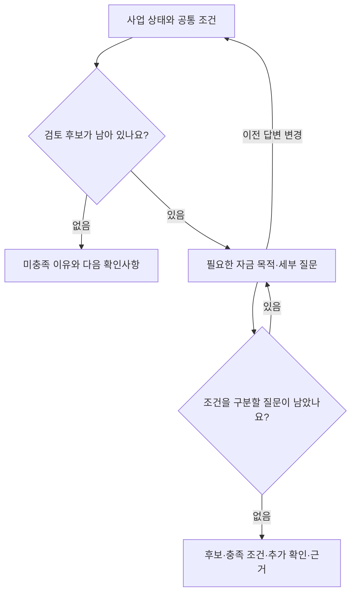

# 질문 분기표

`policy/questions.js`의 순서를 우선하되, 살아 있는 후보의 아직 결론 나지 않은 조건에 필요한 질문만 요청한다. 모든 질문을 고정 순서로 끝까지 묻지 않는다.

| 우선순위 | 질문 ID | 질문 | 응답 형태 | 관련 자금 |
| --- | --- | --- | --- | --- |
| 1 | businessStatus | 현재 사업 상태는 어떤가요? | 단일 선택 | 일반경영안정자금, 장애인기업지원자금, 청년고용연계자금, 긴급경영안정자금 · 일시적경영애로(대리대출), 혁신성장촉진자금, 긴급경영안정자금(재해·직접대출), 일시적경영애로자금(직접대출), 신용취약소상공인자금, 민간투자연계형매칭융자, 재도전특별자금 |
| 2 | businessStatusConfirm | 사업자등록과 영업 상태를 확인할 수 있나요? | 단일 선택 | 일반경영안정자금, 장애인기업지원자금, 청년고용연계자금, 긴급경영안정자금 · 일시적경영애로(대리대출), 혁신성장촉진자금, 긴급경영안정자금(재해·직접대출), 일시적경영애로자금(직접대출), 신용취약소상공인자금, 민간투자연계형매칭융자, 재도전특별자금 |
| 3 | employees | 상시근로자는 몇 명인가요? | 단일 선택 | 일반경영안정자금, 장애인기업지원자금, 청년고용연계자금, 긴급경영안정자금 · 일시적경영애로(대리대출), 혁신성장촉진자금, 긴급경영안정자금(재해·직접대출), 일시적경영애로자금(직접대출), 신용취약소상공인자금, 민간투자연계형매칭융자, 재도전특별자금 |
| 4 | industry | 주된 업종은 어느 쪽인가요? | 단일 선택 | 일반경영안정자금, 장애인기업지원자금, 청년고용연계자금, 긴급경영안정자금 · 일시적경영애로(대리대출), 혁신성장촉진자금, 긴급경영안정자금(재해·직접대출), 일시적경영애로자금(직접대출), 신용취약소상공인자금, 민간투자연계형매칭융자, 재도전특별자금 |
| 5 | smallEnterprise | 업종별 소기업 매출 기준을 충족하나요? | 단일 선택 | 일반경영안정자금, 장애인기업지원자금, 청년고용연계자금, 긴급경영안정자금 · 일시적경영애로(대리대출), 혁신성장촉진자금, 긴급경영안정자금(재해·직접대출), 일시적경영애로자금(직접대출), 신용취약소상공인자금, 민간투자연계형매칭융자, 재도전특별자금 |
| 6 | retainedStatus | 규모가 커졌어도 소상공인 지위가 유지되나요? | 단일 선택 | 일반경영안정자금, 장애인기업지원자금, 청년고용연계자금, 긴급경영안정자금 · 일시적경영애로(대리대출), 혁신성장촉진자금, 긴급경영안정자금(재해·직접대출), 일시적경영애로자금(직접대출), 신용취약소상공인자금, 민간투자연계형매칭융자, 재도전특별자금 |
| 7 | businessForm | 사업자 형태와 영리성을 확인했나요? | 단일 선택 | 일반경영안정자금, 장애인기업지원자금, 청년고용연계자금, 긴급경영안정자금 · 일시적경영애로(대리대출), 혁신성장촉진자금, 긴급경영안정자금(재해·직접대출), 일시적경영애로자금(직접대출), 신용취약소상공인자금, 민간투자연계형매칭융자, 재도전특별자금 |
| 8 | exclusionStatus | 주된 업종이 융자 제외 업종에 해당하나요? | 단일 선택 | 일반경영안정자금, 장애인기업지원자금, 청년고용연계자금, 긴급경영안정자금 · 일시적경영애로(대리대출), 혁신성장촉진자금, 긴급경영안정자금(재해·직접대출), 일시적경영애로자금(직접대출), 신용취약소상공인자금, 민간투자연계형매칭융자, 재도전특별자금 |
| 9 | taxStatus | 국세·지방세 납부 상태는 어떤가요? | 단일 선택 | 일반경영안정자금, 장애인기업지원자금, 청년고용연계자금, 긴급경영안정자금 · 일시적경영애로(대리대출), 혁신성장촉진자금, 긴급경영안정자금(재해·직접대출), 일시적경영애로자금(직접대출), 신용취약소상공인자금, 민간투자연계형매칭융자, 재도전특별자금 |
| 10 | delinquency | 현재 대출금이 연체 중인가요? | 단일 선택 | 일반경영안정자금, 장애인기업지원자금, 청년고용연계자금, 긴급경영안정자금 · 일시적경영애로(대리대출), 혁신성장촉진자금, 긴급경영안정자금(재해·직접대출), 일시적경영애로자금(직접대출), 신용취약소상공인자금, 민간투자연계형매칭융자, 재도전특별자금 |
| 11 | directRecentDelinquency | 최근 3개월의 연체 이력을 확인했나요? | 단일 선택 | 혁신성장촉진자금, 긴급경영안정자금(재해·직접대출), 일시적경영애로자금(직접대출), 신용취약소상공인자금, 민간투자연계형매칭융자, 재도전특별자금 |
| 12 | purpose | 어떤 목적으로 자금이 필요한가요? | 복수 선택 | 일반경영안정자금, 장애인기업지원자금, 청년고용연계자금, 긴급경영안정자금 · 일시적경영애로(대리대출), 혁신성장촉진자금, 긴급경영안정자금(재해·직접대출), 일시적경영애로자금(직접대출), 신용취약소상공인자금, 민간투자연계형매칭융자, 재도전특별자금 |
| 13 | purposeConfirm | 자금 사용처를 더 확인할 수 있나요? | 복수 선택 | 일반경영안정자금, 장애인기업지원자금, 청년고용연계자금, 긴급경영안정자금 · 일시적경영애로(대리대출), 혁신성장촉진자금, 긴급경영안정자금(재해·직접대출), 일시적경영애로자금(직접대출), 신용취약소상공인자금, 민간투자연계형매칭융자, 재도전특별자금 |
| 14 | agencyRestrictions | 대리대출의 나머지 제한사유를 확인했나요? | 단일 선택 | 일반경영안정자금, 장애인기업지원자금, 청년고용연계자금, 긴급경영안정자금 · 일시적경영애로(대리대출) |
| 15 | directRestrictions | 직접대출의 나머지 제한사유를 확인했나요? | 단일 선택 | 혁신성장촉진자금, 긴급경영안정자금(재해·직접대출), 일시적경영애로자금(직접대출), 신용취약소상공인자금, 민간투자연계형매칭융자, 재도전특별자금 |
| 16 | loanHistory | 기존 정책자금 이용 후 신청 가능한 한도가 남아 있나요? | 단일 선택 | 일반경영안정자금, 장애인기업지원자금, 청년고용연계자금, 긴급경영안정자금 · 일시적경영애로(대리대출), 혁신성장촉진자금, 긴급경영안정자금(재해·직접대출), 일시적경영애로자금(직접대출), 신용취약소상공인자금, 민간투자연계형매칭융자, 재도전특별자금 |
| 17 | generalFrequency | 일반경영자금의 지원 횟수 제한을 확인했나요? | 단일 선택 | 일반경영안정자금 |
| 18 | disabledProof | 장애인기업 지원 증빙을 갖추고 있나요? | 단일 선택 | 장애인기업지원자금 |
| 19 | disabledDetails | 장애인기업의 대표자·증빙 세부요건도 확인했나요? | 단일 선택 | 장애인기업지원자금 |
| 20 | businessAge | 신청일 기준 업력은 어느 구간인가요? | 단일 선택 | 청년고용연계자금, 일시적경영애로자금(직접대출) |
| 21 | ownerAge | 대표자의 만 나이는 어느 구간인가요? | 단일 선택 | 청년고용연계자금 |
| 22 | youthEmployment | 청년 근로자 고용 요건에 해당하나요? | 단일 선택 | 청년고용연계자금 |
| 23 | salesDrop | 정해진 비교기간의 매출이 15% 이상 줄었나요? | 단일 선택 | 긴급경영안정자금 · 일시적경영애로(대리대출), 일시적경영애로자금(직접대출) |
| 24 | hardshipException | 매출감소 확인을 생략할 수 있는 대상인가요? | 복수 선택 | 긴급경영안정자금 · 일시적경영애로(대리대출), 일시적경영애로자금(직접대출) |
| 25 | annualRevenue | 연간 매출액은 어느 구간인가요? | 단일 선택 | 일시적경영애로자금(직접대출), 신용취약소상공인자금 |
| 26 | creditScore | NCB 개인신용평점은 어느 구간인가요? | 단일 선택 | 신용취약소상공인자금 |
| 27 | creditAge | 신용취약자금의 인정 업력이 90일 이상인가요? | 단일 선택 | 신용취약소상공인자금 |
| 28 | creditEducation | 지정 신용관리교육을 미리 이수했나요? | 단일 선택 | 신용취약소상공인자금 |
| 29 | creditGrade | 기업신용등급 NICE SOHO ML을 확인했나요? | 단일 선택 | 신용취약소상공인자금 |
| 30 | creditBalance | 신용취약자금의 최소 신청금액이 남아 있나요? | 단일 선택 | 신용취약소상공인자금 |
| 31 | disasterCertificate | 유효한 재해 중소기업·소상공인 확인증이 있나요? | 단일 선택 | 긴급경영안정자금(재해·직접대출) |
| 32 | disasterPause | 재해로 직접 피해를 입어 휴업한 상태인가요? | 단일 선택 | 긴급경영안정자금(재해·직접대출) |
| 33 | innovationPaths | 혁신성장촉진자금의 어떤 유형에 해당하나요? | 복수 선택 | 혁신성장촉진자금 |
| 34 | graduationVerified | 졸업후보기업의 세 가지 요건을 모두 확인했나요? | 단일 선택 | 혁신성장촉진자금 |
| 35 | academyRestrictions | 사관학교 수료 경로의 별도 제한업종을 확인했나요? | 단일 선택 | 혁신성장촉진자금 |
| 36 | investment | 지정 주관기관의 선투자와 추천서를 받았나요? | 단일 선택 | 민간투자연계형매칭융자 |
| 37 | restartPaths | 재도전특별자금의 어떤 경로에 해당하나요? | 복수 선택 | 재도전특별자금 |
| 38 | restartVerified | 선택한 재도전 경로의 세부요건을 확인했나요? | 단일 선택 | 재도전특별자금 |

## 분기 원칙

1. 현재 답변으로 자금별 AND/OR 조건을 평가한다. 어느 필수조건이 확정 미충족이면 그 자금의 나머지 질문을 생략한다.
2. OR에서 한 경로가 충족되면 다른 경로를 확인할 필요가 없다. 청년 대표 요건을 충족하면 청년 고용 질문을 생략할 수 있다.
3. 사업상태 또는 자금용도가 불명확하면 한 번 더 확인한다. 확인 후에도 모름이면 결과의 추가 확인사항으로 남긴다.
4. 상시근로자·소기업 매출기준을 넘으면 법정 지위유지를 확인한다. 20명 이상은 이 유지 경로가 없다.
5. 다른 후보가 남아 있으면 선택한 특별자금 하나 때문에 그 후보를 제거하지 않는다.
6. 답변 변경 시 화면이 변경 지점 이후 답변을 제거한다. 서버도 경로를 처음부터 재생하여 빠진 새 질문 이후의 답변과 무관한 질문을 무시한다.
7. 다음에 필요한 질문이 없으면 종료한다. 남은 미확인 조건이 있는 후보를 충족으로 승격하지 않는다.
8. 모름과 해당 없음은 복수선택에서도 단독 선택이다. 모름은 미충족으로 바꾸지 않는다.

